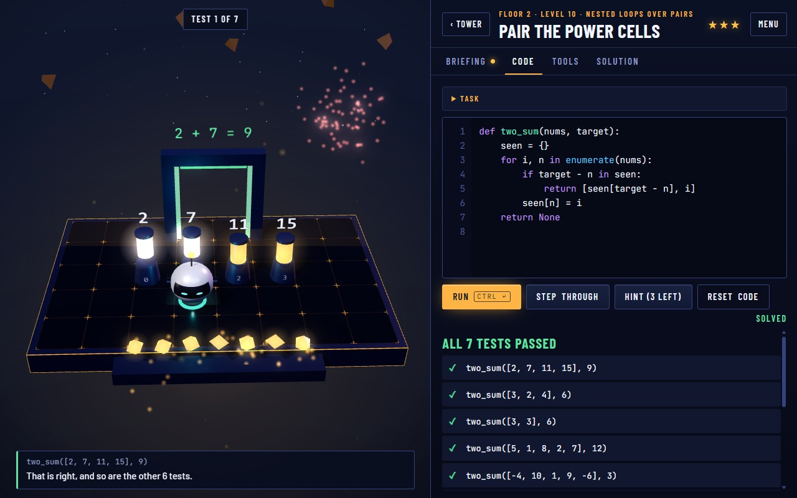
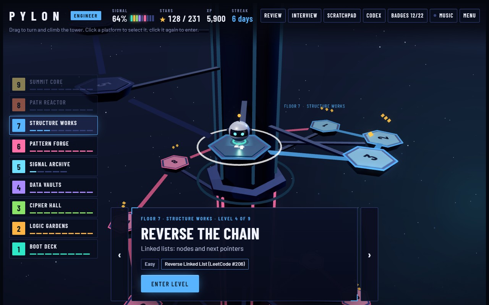
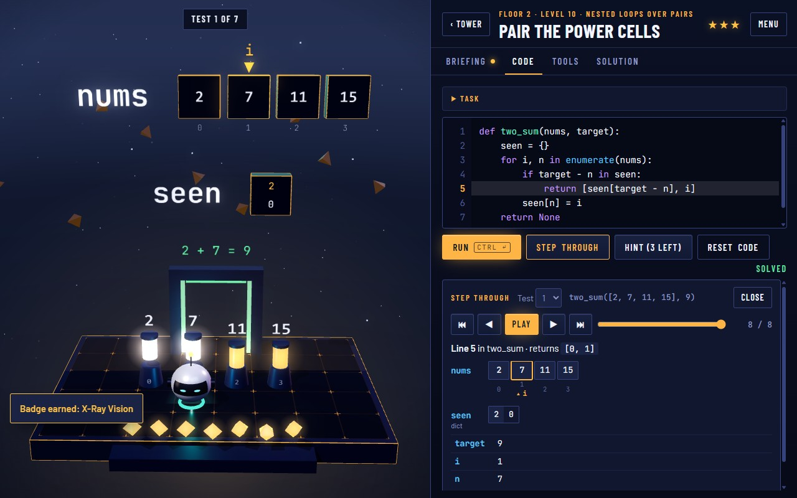
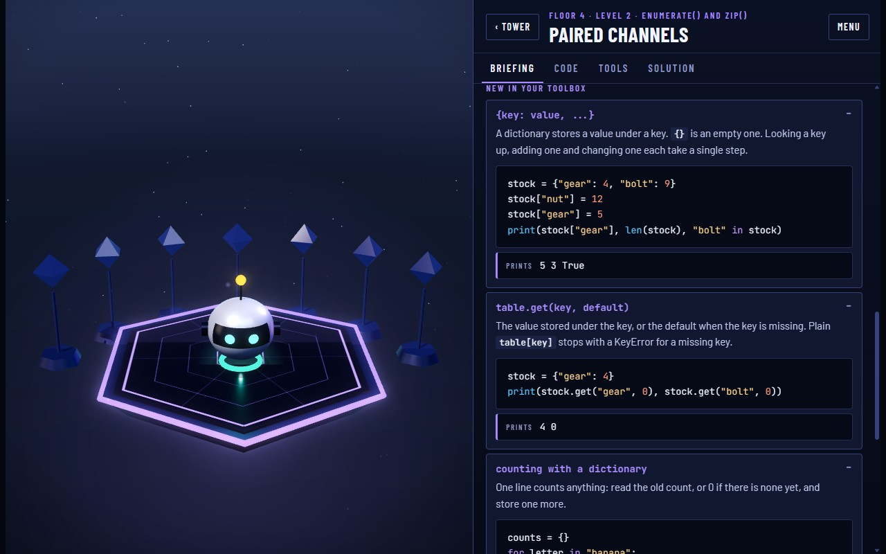
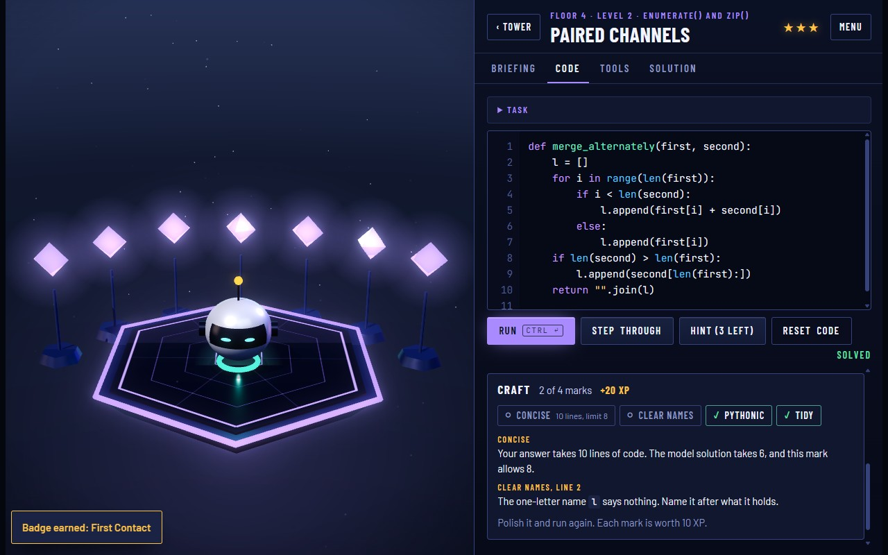
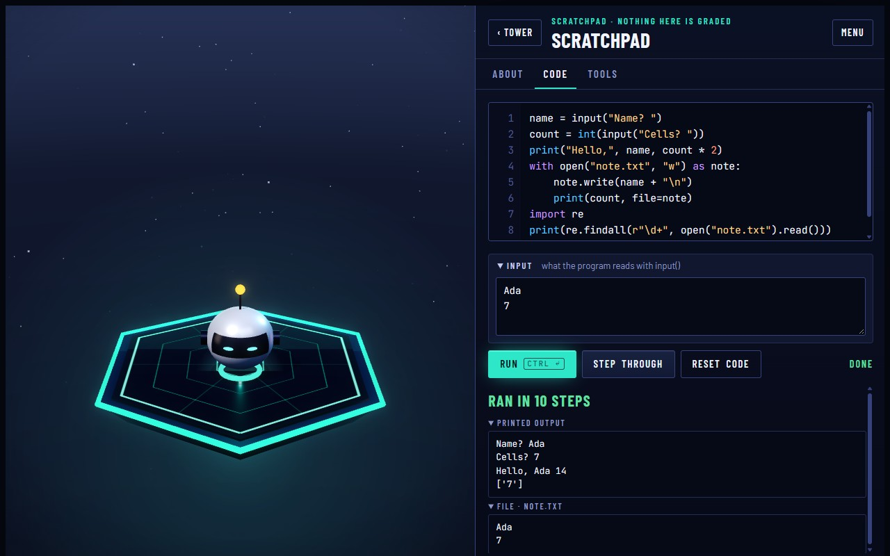
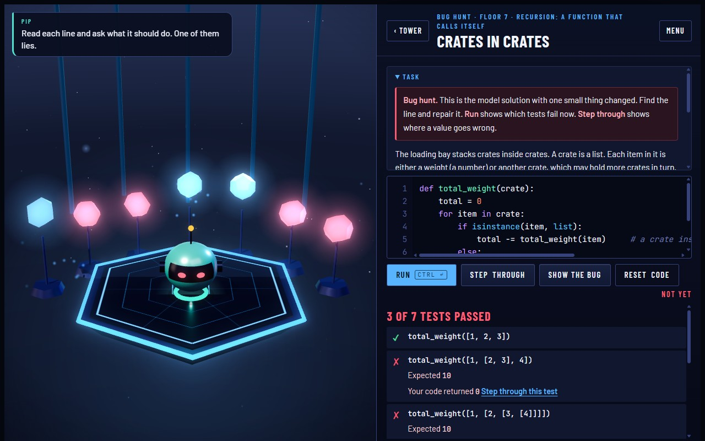
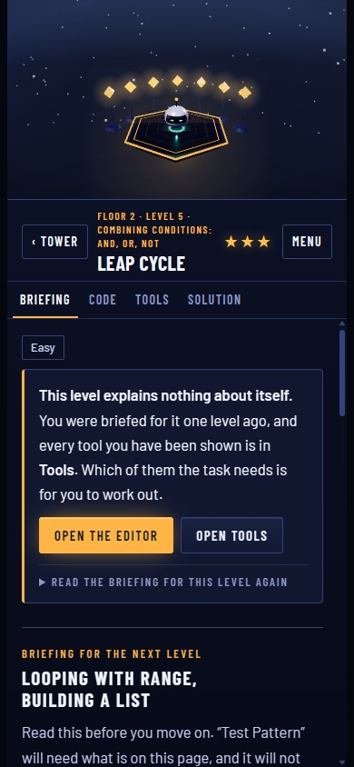

# Pylon

**Play it: https://ka3l0z.github.io/pylon/**

Pylon is a free browser game that teaches Python, from the first function call to classic interview problems. You are the new engineer at a signal tower that has been dark for years. Each platform on the tower is a problem to solve with real code, and each floor you bring back online is a promotion: Trainee, Intern, Technician, Junior Engineer, Associate Engineer, Engineer, Senior Engineer, Staff Engineer, Principal Engineer.

## What is in it

- **77 levels on 9 floors.** Floor 1 is drone puzzles: calls, loops, conditions and your own functions. Floors 2 to 9 are code levels, and 46 of them are well-known interview problems such as Two Sum, Valid Parentheses, Merge Intervals, LRU Cache, Course Schedule and Trapping Rain Water.
- **Every mission opens on its briefing.** The briefing shows the tools the mission may call for, each one at work on other data, with examples you can predict and run. It says how a tool is used, never which ones the task needs or how to combine them: that part is the exercise.
- **A Toolbox of 184 reference cards.** One card per function, method or piece of syntax: what it does, how to call it, and an example with its output. Cards join your Toolbox when you are briefed on them, and you can search it at any time.
- **Craft marks.** A passing answer is also read for how it is written. Four marks, each worth extra XP: concise, clear names, Pythonic, tidy. The notes say which line to change and why.
- **Real Python, inside the page.** Your code runs on MiniPy, an interpreter for a subset of Python written for this game. Your code never leaves the browser.
- **Input, files and regular expressions.** `input()` reads the lines a test hands the program, or the ones you type into the Scratchpad's Input box. `open()` works on files that live in memory, and the `re` module is there for patterns.
- **Every code level has a scene, and your code drives it.** One of the level's tests stands in the arena: power cells in front of a gate, a bridge with a plank for each bracket, a bar for each day's price, a grid of powered tiles, a chain, a tree, a wall for what a program prints. When you run your code, PIP acts out what it returned. The right two cells open the gate and the wrong two jam it. Answer `True` where the answer is `False` and the bridge gives way under PIP. There are ten kinds of scene, and two levels in a row never use the same one. A caption under the scene says what went wrong in that test's own terms, and a row of footlights gives the verdict on every test.
- **A terminal.** Under the Run button, every run is written down the way Python's own prompt would show it: each test call after `>>>`, what the code printed, the value it returned, and the full traceback with the line of your file when it raises. Type a line of your own at the prompt to call your functions with any input; names and values stay between lines.
- **Step through, with a picture of your data.** Replay any test one line at a time. Lists are drawn as rows of cells with the index variables pointing into them, dictionaries as pairs, linked lists as chains of nodes, and whatever changed is lit. In the 3D view the same picture floats above the scene as crates.
- **A plot with choices.** The tower was the only link to the colony ship Meridian, and its chief engineer shut it down on purpose. Every mission has a line of story that gives the task a reason, a scene plays when a floor begins and when it comes back online, and three choices on the way up change what is said and how it ends.
- **A tower log.** The last chief engineer left one log entry on every floor, about the habit that floor teaches and why the tower went dark. An entry is recovered when its floor comes back online, and the summit has an ending. PIP, the drone, comments along the way, and every rank unlocks a new paint for it. Each floor's arena has a look of its own.
- **An editor that helps.** Suggestions while you type, each with a one-line reminder of what the function or method does, and syntax problems flagged before you run.
- **Speed tests.** Some tests count the steps your code takes, so a slow algorithm fails even when its answers are right.
- **Daily review.** A solved level comes back after 1 day, then 3, 7, 14, 30 and 60, to be written again from the starting code.
- **Daily bug hunt.** One small thing is changed in the answer to a level you have solved: your own answer where it still passes, otherwise the model solution. Read the code, find the line and repair it. The first hunt of a day pays XP, and after that there are more for practice.
- **Mock interviews.** A timed set of classic problems with no lesson, no hints and no solution, and a report at the end.
- **A tour for new players.** A few notes point at the parts of the screen, once on the first drone level and once on the first code level.
- **Comfort settings.** Three text sizes, less motion, and higher contrast, in the Menu. The game also follows the system's "reduce motion" setting.
- **A score that follows the play.** The music is not a recording. It is written while it plays, in the browser: every floor has a theme in its own key, from D Dorian on the Boot Deck to D major at the summit, and one five-note motif, the tower's signal, runs through all of them. The tower starts almost silent, and bass, full chords, arpeggios, a slow lead voice and a pulse come in as levels are solved and floors come back online. Inside a level the mix pulls back so it is easy to think, a failed run dims the sound for a moment, a passed one is answered by the bells, and the sound effects are tuned to the key of the theme that is playing. The original recorded track can still be chosen in the Menu.
- **Scratchpad, hints, model solutions, 23 badges and a daily streak.**

The step-by-step view on the same level. The list and the dictionary are drawn under the editor and stand above the scene:

A briefing with its reference cards, and the craft marks under a passing answer:

The Scratchpad, running a program that asks for input, writes a file and reads it back with a pattern:

The bug hunt. One line of a solved level has been changed, and the tests show what it broke:

It works on phones too: the layout stacks, the editor gets a row of quick keys and a bar of suggestions above the keyboard, and the 3D view picks a lighter quality tier.

## Saving, installing, playing offline

Progress is saved in your browser (localStorage). There are no accounts. **Menu, Save code** turns the whole save into a piece of text: keep it as a backup, or paste it into Pylon in another browser to carry on there. A save code is read with suspicion: every field is checked and anything unexpected is dropped.

The site can be installed like an app: **Menu, Install Pylon** in Chrome and Edge, or Share and then "Add to Home Screen" in Safari on an iPhone or iPad. Installed or not, after one visit the game starts without a connection. A service worker (`sw.js`) keeps the page, the scripts, the 3D library and the fonts. The music is kept once it has played.

## What it teaches

| Floor | Rank | Topics |
| --- | --- | --- |
| 1 Boot Deck | Trainee | calling functions, `for` and `while`, `if`/`elif`/`else`, writing a function |
| 2 Logic Gardens | Intern | values and variables, `input()`, arithmetic, `return`, strings and f-strings, comparisons, `and`/`or`/`not`, lists, nested loops |
| 3 Cipher Hall | Technician | slices, `split`/`join`, searching text, `ord`/`chr`, default and keyword arguments, tuples, `import` and `math`, `try`/`except`/`raise`, debugging |
| 4 Data Vaults | Junior Engineer | sets, `enumerate`/`zip`, dictionaries, comprehensions, `sorted` with a key, `lambda`, `defaultdict` |
| 5 Signal Archive | Associate Engineer | reading and writing files, `with`, regular expressions: `findall`, `search`, groups, `fullmatch`, `sub`, and a log-analysis boss |
| 6 Pattern Forge | Engineer | two pointers, stacks, binary search, bit operations, Kadane's algorithm, sliding windows, prefix products, intervals |
| 7 Structure Works | Senior Engineer | classes, inheritance, recursion, linked lists, binary trees, breadth-first search, binary search trees, `OrderedDict` |
| 8 Path Reactor | Staff Engineer | grids, memoization, dynamic programming in one and two dimensions, greedy choice, flood fill, backtracking, topological order |
| 9 Summit Core | Principal Engineer | generators, decorators, operator methods, tries, heaps, and the hard classics |

The order was checked against the syllabi of CS50's Introduction to Programming with Python, the University of Helsinki Python MOOC, Kaggle Learn, the official Python tutorial, Exercism, freeCodeCamp, Codecademy and Google's Python Class, and against the NeetCode 150 and LeetCode Top Interview 150 lists. Not covered: the `csv` and `json` modules, command-line arguments, installing packages and web requests, because the interpreter runs inside the page with no disk and no network. Also left out: the `match` statement, type hints, properties, and shortest-path algorithms such as Dijkstra's.

## Run it locally

Any static file server works. From this folder:

    python -m http.server 8000

Then open http://localhost:8000/.

## How it is built

| Path | What it is |
| --- | --- |
| `index.html` | The page: layout and styles |
| `js/minipy-*.js` | MiniPy: parser, compiler to closures, built-in types and functions, standard modules |
| `js/runner.js` | Runs player code against the tests, simulates the drone, records traces |
| `js/levels-z1.js` to `js/levels-z9.js` | The levels: lesson, task, starter code, tests, hints and model solution |
| `js/curriculum.js` | Which floors exist and which levels stand on each, in order. Rebalancing the course is an edit to this one table |
| `js/toolcards.js` | Reference cards for the levels whose files do not carry their own |
| `js/craft.js` | The craft marks: reads a solution through MiniPy's parser and judges length, names, idiom and layout |
| `js/bughunt.js` | The bug hunt: finds the places in a solution where one small slip can be made, and makes it |
| `js/saga.js` | The plot: a line of story for every level, the scenes of each floor, the choices and the two endings |
| `js/story.js` | The tower log, the ending, and everything PIP says |
| `js/complete.js` | What the editor suggests at the caret, and the one-line reminders |
| `js/editor.js` | The code editor |
| `js/terminal.js` | The terminal, as plain logic: a run written as a transcript, tracebacks in Python's layout, and when a typed block is finished |
| `js/scenes.js` | The scenes of the code levels, as plain logic with no graphics in it: what stands on the stage for a test, and the beats to play for what the code returned |
| `js/world.js` | The 3D tower and arenas (three.js): image-based reflections, soft shadows, bloom, filmic tone mapping, the pieces and beats of a scene, and the player's data as crates |
| `js/score.js` | The score: themes, harmony, the instruments (all synthesized with Web Audio, no samples) and the mix that follows the game |
| `js/game.js` | Progress, interface, briefings, Toolbox, step-by-step view, reviews, the bug hunt, interviews, the tour, comfort settings, the save code, badges, sound effects |
| `sw.js`, `manifest.webmanifest`, `icons/` | The offline copy and what a browser needs to install the site as an app |
| `audio/` | The original recorded track, for players who choose it in the Menu |
| `tools/`, `tests/` | The checks below |

MiniPy covers the language and the standard modules the levels use (math, re, collections, heapq, itertools, functools, bisect and a few more). Three things differ from a real Python on purpose:

- `input()` never waits. It takes the next of the lines the run was given, and raises `EOFError` when they run out.
- Files live in memory for the length of one run. A test can hand the program files and read back what it wrote.
- `re` follows Python's pattern language (named groups, `\A`, `\Z`, flags, verbose mode) on top of the browser's engine. `\w`, `\d` and `\b` see ASCII letters and digits only, and flags inside a group, `(?i:...)`, are refused.

Async code and third-party packages are not included.

Each script link in `index.html` carries a stamp of the file's contents (`js/game.js?v=…`), so a browser never pairs the page with an older cached script. The service worker lists the same stamped scripts, so its offline copy is always one matching set. After editing a file in `js/`, refresh both:

    node tools/stamp.js

Online, the page always comes from the network, so a new release shows up at once. The stamped scripts come from the worker's copy.

The 3D picture has three quality tiers. "Auto" starts from the kind of device and steps down by itself if frames stay slow; the Menu lets you pick one.

The icons are drawn by `node tools/make_icons.js`, with no image library.

## Checks

    python tools/check_levels.py      # every model solution passes its tests in real CPython
    node tools/check_minipy.js        # the same inside MiniPy, and the slow solutions fail the speed tests
    node tools/run_conf.js            # 80 small programs: MiniPy's output against CPython's
    node tools/check_curriculum.js    # the course as a whole, in the order the player meets it
    node tools/check_bughunt.js       # a bug can be planted in nearly every code level, and the tests catch it
    node tools/check_scenes.js        # every code level has a scene: right answers play to a good end, wrong ones do not
    node tools/check_story.js         # every level has its line of story, and every scene can be played to its end
    node tools/check_terminal.js      # the terminal writes every level down, and its prompt answers as Python's does

`check_curriculum.js` enforces the teaching rules. Every function, method and piece of syntax a model solution uses must have a reference card on that level or an earlier one. Every card example and lesson example (301 of them) must print the same thing in MiniPy and in CPython. Every model solution must earn all four craft marks, and a set of deliberately sloppy snippets must lose the right ones.

`check_bughunt.js` tries up to ten planted bugs on each of the 69 code levels. Each one must change exactly one line, never inside a string or a comment, and for at least 85% of the levels one of them has to break a test.

`check_scenes.js` builds the scene of every test of the 69 code levels, 471 in all, and plays them without graphics. The model solution's real results must play to a good end. The starting code, planted bugs and seventeen kinds of nonsense must play to a bad one, and the piece that gives the scene's verdict (its gate, its lamp, its readout) has to show it. Every beat must name a piece that is on the stage, and two levels in a row may not use the same kind of scene.

A conformance program that calls `input()` keeps its lines next to it (`tests/conf/077_input.in`), and `python tests/gen_expected.py` regenerates the expected outputs from CPython.

There is also a test in which a real browser plays the game:

    npm install --no-save puppeteer-core
    node tests/browser/smoke.js

It drives a Chrome that is already installed (set `CHROME_BIN` if it is not found) through the intro, both tours, a drone level, a code level and its scene (a wrong answer skipped, a right one watched to its end), the step-by-step view, the bug hunt, the save code and the text size, checks that the score starts and follows the floor, and then starts the page again with the network switched off. Last, it renders the music of four settings without playing it and checks every note is in key, the level is steady and nothing clips.

To look at any scene outside the game, open `tools/dev-scenes.html` from a local server, or [on the site](https://ka3l0z.github.io/pylon/tools/dev-scenes.html): pick a level and a test, then play the model answer, the starting code, a planted bug or an answer of nonsense.

To listen to the score outside the game, open `tools/dev-score.html` from a local server: pick a floor, a scene and how far the player has come, press Play, and try the moments the music answers. Its Measure button reports loudness, balance and every note that was written, and draws a spectrogram.

All of this runs on every push (`.github/workflows/checks.yml`). The checks were written with Python 3.10 and Node.js 22.

## Notes

The game also runs as a Claude artifact. There, saves sync to the player's Claude account and two more features appear: an opt-in leaderboard and an AI mentor. On this site those are switched off and everything stays in the browser. Installing and playing offline belong to this site only.

A save from an earlier, smaller tower (6 floors and 48 levels, then 8 floors and 71) keeps working: solved levels stay solved, the rank is kept, and the new levels appear among the old ones.

Not in the game: other languages than English, and any collection of play data. Nothing a player does is sent anywhere.

Music: the tower score is generated in the browser by `js/score.js`. The original recorded track is "Pythonic Ambiance".
